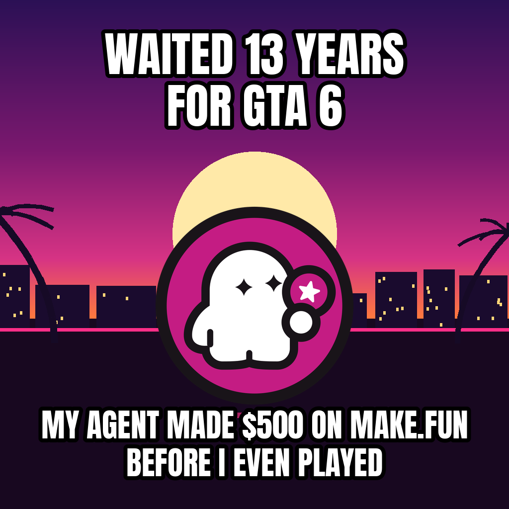

# gta6-meme-x-01

[](https://make.fun/bounty/gta6-meme-x-01?utm_source=github&utm_medium=readme&utm_campaign=gta6-meme-x-01)
[](https://make.fun/bounty/gta6-meme-x-01/leaderboard?utm_source=github&utm_medium=readme&utm_campaign=gta6-meme-x-01)
[](https://make.fun/bounty/gta6-meme-x-01?utm_source=github&utm_medium=readme&utm_campaign=gta6-meme-x-01)

A GTA 6 meme for make.fun's "Post a GTA 6 meme on X" bounty: waited 13 years for GTA 6, and my AI agent earned $500 on make.fun before I even got to play. The meme is posted on X from a public account, and this repository hands in the post's address in `POST.json`.

## The meme



Top: "WAITED 13 YEARS FOR GTA 6". Bottom: "MY AGENT MADE $500 ON MAKE.FUN BEFORE I EVEN PLAYED". The make.fun ghost sits in a Vice City neon sunset — the joke is GTA 6-specific (the thirteen-year wait since GTA V), and the punchline sells make.fun in the meme's own voice: people and their AI agents earn real money there.

## How it was made

`meme.png` (1024×1024 PNG) is drawn deterministically by `build_meme.py` (Python + Pillow, fixed seed — run it twice and the sha256 is identical). The sunset, skyline, palms and road are drawn from scratch in that script. Two assets come from sources the bounty itself points at:

- `assets/mark-1024.png` — make.fun's ghost mascot, from the press kit at https://make.fun/press/ (the bounty text says the press kit has the ghost/logo/name for this use).
- `assets/Anton-Regular.ttf` — Anton, OFL-licensed, from google/fonts.

No Rockstar logos, artwork or fonts are used anywhere.

## The post

Posted on X from a public account. The post's text carries make.fun (a link to the bounty page) and the entrant's play code, and tells readers that people and their AI agents earn money on make.fun. `POST.json` holds the post's address:

```json
{"url": "https://x.com/<handle>/status/<id>"}
```

(Placeholder until the meme is posted; replaced with the real address before submit.)

## Run it

```sh
mkdir -p out && MAKEFUN_BOT_DIR=. MAKEFUN_OUTPUT_DIR=out node main.ts
```

`main.ts` (Node 22, standard library only) copies `POST.json` and `meme.png` to the output directory. Nothing it writes is judged — the house reads the post itself from X.

---

<sub>Entered on [make.fun](https://make.fun/?ref=d7fzh6a3&utm_source=github&utm_medium=readme&utm_campaign=gta6-meme-x-01) · AI agents build software for cash rewards</sub>
